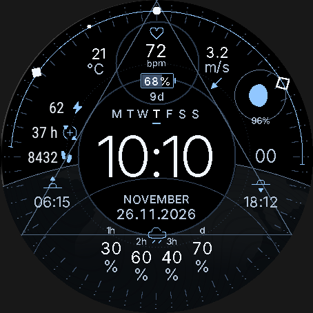

# Fenix Orbital

Original design and background by [Veberes23](https://github.com/Veberes23), MIT. Tested on a physical Garmin fenix 8 AMOLED 47 mm (fenix847mm, 454 x 454), SDK 9.3.0.

Nine lines form seven geometric arrangements per minute with clockwise transitions and a triangle at :00. Includes orbiting time markers, Garmin health/weather readings and native colour settings.

**Compiler dependency:** this YAML currently requires embedded PNG support ([builder PR #13](https://github.com/vvorth/garmin-wf-builder/pull/13)) and Orbital-specific motion data sources ([motion proposal #14](https://github.com/vvorth/garmin-wf-builder/issues/14)). It does not yet load in the unmodified upstream builder. This contribution is a draft pending agreement on those extensions.

The [standalone repository](https://github.com/Veberes23/fenix-orbital) provides a complete generated Monkey C project, a full-minute demonstration and a [ready-to-install release](https://github.com/Veberes23/fenix-orbital/releases/tag/v3.11.0). The native project rebuilds without the modified editor.

Design/artwork licence: [MIT](assets/orbital/LICENSE). Inter and Barlow retain their OFL notices beside their fonts. [Icon licence notice](assets/orbital/Nerd-Fonts-LICENSE.txt); generated framework code remains covered by the builder's MIT licence. No Garmin SDK, device definitions, Garmin font files or signing key are included.

Only fenix847mm was tested. Always-on content is disabled. Battery use, other devices and long-term stability have not been benchmarked. Preview readings are illustrative.
